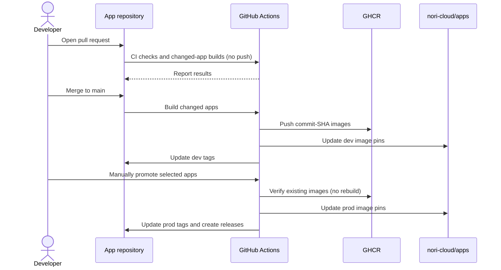

## What am I looking at?

Set up GitHub Actions using [Factory](https://github.com/nori-cloud/factory) as
the reference. The pipeline ends at updating image pins in `nori-cloud/apps`.



## What do I need?

- GitHub Actions enabled, with access to `nori-cloud/actions`.
- A pnpm project with `packageManager` in `package.json`, a committed lockfile,
  and a sanity command. `setup` uses Node.js 22 and installs with
  `--frozen-lockfile --ignore-scripts`.
- A Dockerfile per app, normally `apps/<app>/Dockerfile`.
- Dev and prod overlay files prepared using [Set up GitOps apps](set-up-gitops-apps.md).

## How do I configure access?

Create a GitHub App with **Contents: Read and write**, install it on
`nori-cloud/apps`, and add these secrets to the application repository:

| Secret | Value |
| --- | --- |
| `GITOPS_APP_ID` | GitHub App ID |
| `GITOPS_APP_PRIVATE_KEY` | Complete PEM private key |

Allow the App to push under the GitOps repository's branch rules. Allow the
workflow's `GITHUB_TOKEN` **packages: write** for GHCR and **contents: write**
for tags and releases. Tag rules must
permit moving `<app>-dev` and `<app>-prod`.

## Which workflow files should I copy?

Copy these into your application's `.github/workflows/`, keeping their names:

| Factory file | Purpose |
| --- | --- |
| [ci.yaml](https://github.com/nori-cloud/factory/blob/main/.github/workflows/ci.yaml) | Pull request checks |
| [cd.yaml](https://github.com/nori-cloud/factory/blob/main/.github/workflows/cd.yaml) | Dev image-pin updates on merge |
| [prod-promote.yaml](https://github.com/nori-cloud/factory/blob/main/.github/workflows/prod-promote.yaml) | Manual production promotion |

Image builds call the shared
[`build-image` action](../README.md#how-do-i-build-an-image) from `nori-cloud/actions`
under `steps`, after checkout; do not copy a local image workflow. Factory
references `@main`; pin a reviewed commit containing the action for production.

## What should I change?

1. Replace `app-list` in both CI and CD with your apps. For example:

   ```json
   [{"app": "outpost", "paths": ["apps/outpost/**", "packages/ui/**"]}]
   ```

   `app` must match the image name and GitOps directory. `paths` are directory
   prefixes, not arbitrary globs; include shared packages. Set `dockerfile`
   when it is outside `apps/<app>/Dockerfile`. Every selected app needs overlays;
   Factory's `deploy` field does not filter the deployment matrix.
2. Replace `pnpm turbo lint typecheck build` if your sanity command differs.
3. Review change detection: CI uses `origin/main` with full history; Factory CD
   uses `HEAD^1` with two commits fetched, covering only the last commit.
   Adjust the comparison for multi-commit pushes. Its CD trigger only includes
   `apps/**` and `packages/**`, not root lockfile changes.
4. Replace the promotion app inputs, `PROMOTE_*` variables, and matching shell
   selection lines together. Leave `sha` blank to follow each app's dev tag,
   or supply a full SHA with an existing image.

Two current limits: the GitOps action authenticates specifically for
`nori-cloud/apps`, and concurrent overlay pushes can conflict. Start with one
app and one update at a time.

## How do I verify it?

1. Open a PR changing the app: sanity and image builds pass without publishing.
2. Merge: confirm the full-SHA image in GHCR, the dev overlay's `newTag`, and
   `<app>-dev` plus its timestamped tag.
3. In **Actions → Prod Promote → Run workflow**, select the app and enable
   `dry-run`. Confirm the planned overlay and tag changes.
4. Run again without dry-run. Confirm the prod image pin, `<app>-prod`, its
   timestamped tag, and the GitHub Release.

## Is there any external references to this documentation?

- [Factory workflows](https://github.com/nori-cloud/factory/tree/main/.github/workflows) — complete examples.
- [Action definitions](../README.md#actions) — available shared actions.
